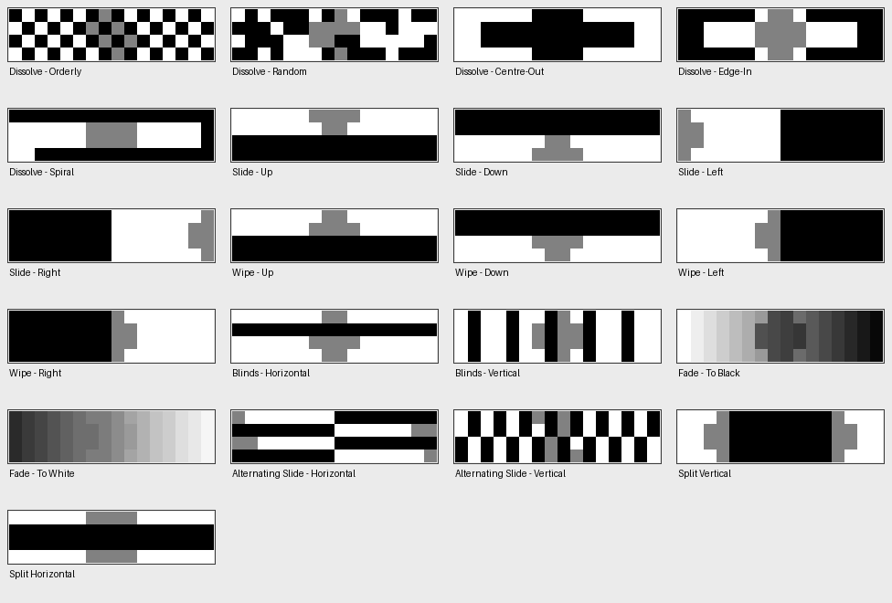

# Transition Builder

A plugin for the PPUC Colorizing DMD editor (the Serum editor). It builds transitions for you on
new frames, or as a scene, from a frame of your project. It needs the editor's plugin API version
9 (PPUC Colorizing DMD 3.99.39 or later).

| Transition | Options | What it does |
| --- | --- | --- |
| **Alternating Slide** | Horizontal, Vertical | Horizontal: the 1st, 3rd, 5th ... row slide left, the 2nd, 4th ... row slide right. Vertical: the 1st, 3rd ... column go up, the 2nd, 4th ... column go down. |
| **Blinds** | Horizontal, Vertical | Black bars at regular intervals grow wider. |
| **Dissolve** | Orderly, Random, Centre-Out, Edge-In, Spiral | Pixels turn black: in a regular pattern, at random, from the centre outward, from the edges inward, or along a spiral. |
| **Fade** | To Black, To White | The picture gets darker (brighter) with every frame. |
| **Slide** | Up, Down, Left, Right | The whole picture slides off the screen. |
| **Split** | Horizontal, Vertical | Cut in the middle; the halves slide apart. Horizontal: cut across, the halves go up and down. Vertical: cut down, the halves go left and right. |
| **Wipe** | Up, Down, Left, Right | A black bar wipes over the picture, moving in the direction you choose (Left: it comes in from the right edge). |

The last frame of a transition is never completely black (or white): a dissolve ends with a few
pixels still lit, the sliding ones with a thin strip of the picture, a fade with a color one
step from black (white).

## How to use it

1. Open your project and select the frame you want to start the transition from.
2. Choose `Plugins -> Transition Builder...`. One window opens:
   - **Transition:** the transition. The next field changes with it.
   - **Option:** the transition's direction, dissolve type ... Its name and its list depend on the
     transition. The window remembers the option of each transition.
   - **Number of frames:** the list holds only the numbers that work for that transition on your
     frame (see below), so there is nothing to mistype. A number you chose stays chosen while
     the transition can make that many frames.
   - **Place the new frames:** right after the starting frame, at the end of the project, or as a
     scene that the starting frame starts (see "As a scene" below).
   - **Preview:** four frames of the transition, drawn from your frame exactly as `Apply` will
     make them.
3. Click `Apply`. `Cancel` changes nothing.

The window does not block the editor. While it is open you can click another frame in the frame
list: the window then starts from that frame, and the preview shows it. The window opens on the
choices you applied last.

### Why the number of frames is limited

Every frame of a transition has to differ from the others. A slide moves whole pixels, so a
frame 32 pixels tall can only be in so many places; blinds can only grow as wide as the gap
between them. Each transition therefore has a most for the size of your frame, and the list in
the window stops there. On a 128 x 32 frame, for example: Dissolve 255, Split Horizontal 15.
Larger frames (192 x 64, 256 x 64) allow more. A fade is limited by how many brightness levels
the picture has.

### What Apply makes

The plugin adds that many new frames. Each new frame is a copy of
the frame you started from, one step further along the transition than the one before. The new
frames are selected afterwards, so you can use them right away. Placing them after the
starting frame moves them as one block, so sections and the order of the project stay right. It is all one step of the
editor's history: **one `Undo` removes all the new frames.** The frame you started from is never
changed.

The new frames have **no comparison mask** (the mask of the frame you started from is not
copied; its shape mode is). They keep the frame's display time. To change it, use the editor's
`Duration` field in the Frame section: the plugin leaves the new frames selected, and `Duration`
applies to all selected frames. (The editor's plugin API cannot set a frame's duration.)

### As a scene

`As a scene that the starting frame starts` is offered in projects of 128 x 32 frames (libserum
plays scenes in no other). The plugin makes the frames as above, makes a scene of them behind the
last frame of the project, lets the starting frame start it (its Scene field), and removes the
plain frames again. The window then also asks for the scene's **frame duration** in milliseconds;
it starts as the duration of your frame. The scene's other settings are the editor's defaults
(played once, keeps its last frame, no flags); change them in the editor's Scenes section. If the
starting frame started another scene before, it starts the new one now, and the plugin tells you.
A frame of a scene has no dynamic zones, so the scene's frames have none.

All of it, frames and scene, is one step of the editor's history.

## Installing it

1. Get the plugin folder `TransitionBuilder` (see "Getting the plugin" below). It contains
   `plugin.cfg` and `plugin-transitionbuilder64.dll`.
2. In the editor, open `Settings -> Plugins` and click `Open Folder`. Put the whole
   `TransitionBuilder` folder into that folder (usually
   `%APPDATA%\ppuc.org\PPUC Colorizing DMD\plugins`), so that `plugin.cfg` is at
   `...\plugins\TransitionBuilder\plugin.cfg`.
3. Restart the editor, open `Settings -> Plugins`, and check `Transition Builder`.
4. A `Plugins` menu appears with the entry `Transition Builder...`.

If the plugin does not load, `Settings -> Plugins` names the reason, and `Help -> Plugin Log`
has more.

## Getting the plugin (Windows, no programming tools needed)

GitHub builds it for you:

1. Make a free account at github.com and create a new repository (private is fine).
2. Upload everything in this folder to it, including the hidden `.github` folder
   (`Add file -> Upload files`; drag the whole folder in).
3. Open the repository's `Actions` tab. The `Build Windows plugin` run starts by itself after
   the upload (or choose it and click `Run workflow`).
4. When the run is green, open it and download `TransitionBuilder-windows-x64` under
   `Artifacts`. Unpack it: it holds the `TransitionBuilder` folder from the steps above.

## What it does not do (yet)

- It starts from the **current frame** only, and the transition always goes to black (or white).
  Transitions from one frame to another are planned.
- It works on the original frame and the one colorized picture; with an HD plane the plugin
  moves it in 2x2 blocks, as the editor's HD plane works.
- **Backgrounds:** where a frame shows its background, those pixels stay as they are, because the
  plugin API cannot change a frame's background mask. The plugin tells you when the frame has one.
- Black pixels are black in the frame's original shades and in the pictures, and they are taken
  out of the dynamic zones. In moving transitions the dynamic zones move with the picture.
- **Fade:** the colors of the picture and the frame's dynamic colors fade. Color rotations of the
  new frames are removed (they would keep turning the colors at full brightness).

## Adding another transition

Everything about a transition is in `src/Transitions.h`. A transition is a class (an `Effect`)
that answers, for a pixel (x, y) of the new frame at step N of M: which pixel of the starting
frame does it show, or is it black? It also says its most frames (`maxSteps`). Add one entry to
`kTransitions` (with its options) and it appears in the window. Nothing else changes: the same
answers are used for the original shades, the pictures, the dynamic zones and the preview
(`src/Preview.h`).

## Files

- `plugin.cfg`: what the editor reads to find the plugin.
- `src/TransitionBuilder.cpp`: the plugin (menu entry, the window, creating the frames and the
  scene).
- `src/Preview.h`: drawing the steps of a transition, for the new frames and the preview.
- `src/Transitions.h`: the transitions.
- `include/`: the editor's plugin API (`ColorizingDMDPlugin.h`, version 9, from
  PPUC-Colorizing-DMD) and the VPX plugin SDK header (`plugins/MsgPlugin.h`).
- `tests/`: tests that run the plugin against a fake editor.

## License

GPL-3.0-or-later, like the editor and the headers in `include/`.

## Some Sample Transitions

Alternating Vertical

Blinds Vertical

Dissolve Random

Fade to Black

Slide Right

Split Vertical

Wipe Centre-Out

Wipe Spiral

